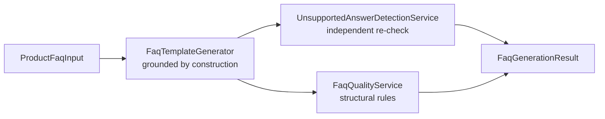

# Architecture

## Pipeline



### ASCII fallback

```
ProductFaqInput
      |
      v
FaqTemplateGenerator  (one FAQ per supplied field; skips what's missing)
      |
      +-----------------------+
      v                       v
UnsupportedAnswerDetection   FaqQualityService
(number+unit + color claims   (duplicates, empty answers,
 re-checked against source)    answer-echoes-question)
      |                       |
      +-----------------------+
                v
        FaqGenerationResult
```

## Components

| Component | Responsibility |
|---|---|
| `FaqTemplateGenerator` | Builds each FAQ directly from one input field — grounded by construction |
| `UnsupportedAnswerDetectionService` | Independently re-verifies every answer against the original input |
| `FaqQualityService` | Structural rules independent of groundedness (duplicates, circularity, emptiness) |
| `FaqGenerationPipelineService` | Orchestrates all three |

## Important Interfaces

- `UnsupportedAnswerDetectionService.check(faqs, source)` takes the
  **generated FAQs and the original input as two separate arguments** —
  it never assumes the generator that produced the FAQs is trustworthy,
  which is what makes it meaningful even if a future generator replaced
  `FaqTemplateGenerator`.
- Two independent, targeted checks (number+unit claims, color claims)
  rather than one broad "does every word appear in the source" check —
  a broad token-overlap check would false-positive on ordinary template
  connector words ("is," "designed," "available"); these two are narrow
  enough to only flag genuinely checkable, specific claims.

## External Dependencies

- Spring Web, Spring Validation (runtime)
- Spring Boot Test (JUnit 5, AssertJ — test scope only)
- No LLM dependency — see docs/design-decisions.md

## Decision Points

- **Missing optional fields skip their FAQ rather than filling a
  placeholder.** No `useCase` supplied means no "best suited for" FAQ —
  never a generic filler answer standing in for data the pipeline
  wasn't given.
